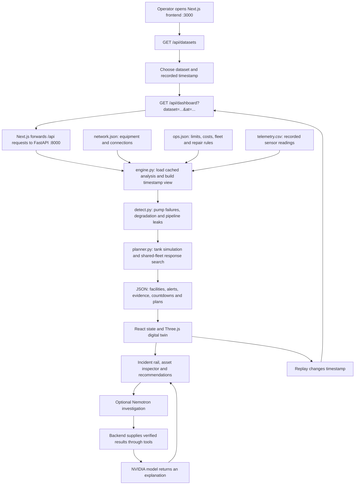

# NightShift AI: End-to-End Flow

**Purpose:** replay recorded oilfield telemetry, detect equipment problems, estimate shutdown risk, and recommend a costed response. It is decision support: it does **not** control equipment or dispatch trucks.

## Overall flow



## What each part does

```text
frontend/
├─ app/page.tsx                 Loads data; owns dataset, selection, navigation and replay state
├─ app/globals.css              Seamless workspace styling and responsive layout
├─ lib/api.ts                   HTTP requests, query parameters and error handling
├─ lib/scene-layout.ts          Turns real equipment IDs/relationships into schematic positions
├─ lib/operational-status.ts    Display status, colors and formatting
├─ components/digital-twin/     Three.js models, lighting, camera and selectable labels
└─ components/control-room/     Header, incidents, inspector, replay and Nemotron UI

backend/
├─ main.py                     FastAPI routes and optional NVIDIA tool-calling integration
├─ dataset.py                  Reads the three input files and indexes sensor histories
├─ detect.py                   Learns baselines; uses residual/CUSUM analysis and pump status
├─ planner.py                  Simulates tanks; evaluates trucks, trips and well shut-ins
└─ engine.py                   Combines detection/planning into a cached operator view

data/eog/                      Dataset folders; each system keeps its own disposal site and yard
scripts/validate_history.py    Checks detected events/plans against answer keys offline
scripts/kpi.py                 Reports detection, response, fleet and engine performance
tests/                         Backend verification
```

## What happens when you interact

| Action | End-to-end result |
|---|---|
| Open/change dataset | Discover folders containing all three input files; load their dashboard. The frontend defaults to the October 8 noon snapshot when available. |
| Play/scrub replay | Send a new `at` timestamp; backend returns that moment's visible incidents, readings and plans. Playback waits for each response; scrubbing is debounced. |
| Select an incident/equipment | Resolve its actual asset ID, highlight it and show contextual information. Full inspection fetches sensor history through `/api/trend`; camera gestures stay in the browser. |
| View a recommendation | Pump failures receive shutdown estimates and simulated response options. Plans account for trucks shared **within each system**. Leaks/degradation receive inspection advice without an invented shutdown countdown. |
| Investigate with Nemotron | `/api/investigate` uses `NVIDIA_API_KEY` and optional `NVIDIA_MODEL`. Tools expose telemetry evidence, the verified plan and planning limits. The model explains results; it does not perform the optimization. Missing credentials return an explicit error. |
| Export from the header | Download a browser-generated JSON snapshot of the currently loaded incidents. The separate `/api/events` endpoint provides the backend event-history export. |

## Important boundaries

- Data comes from local recordings, **not live field sensors**. No database is required; analysis and timestamp views are cached in backend memory.
- Runtime analysis reads `network.json`, `ops.json` and `telemetry.csv`. Answer keys are used only for offline validation/scoring.
- Optimization searches the implemented response space under the simulator's assumptions; it is not a claim of unrestricted global optimality.
- Additional backend routes provide health status, a shift handoff brief and hypothetical fleet-size studies; these are separate from the main dashboard flow.

**In one line:** recorded files → deterministic detection → simulation/planning → API JSON → interactive 3D workspace → optional AI explanation → operator decision.
