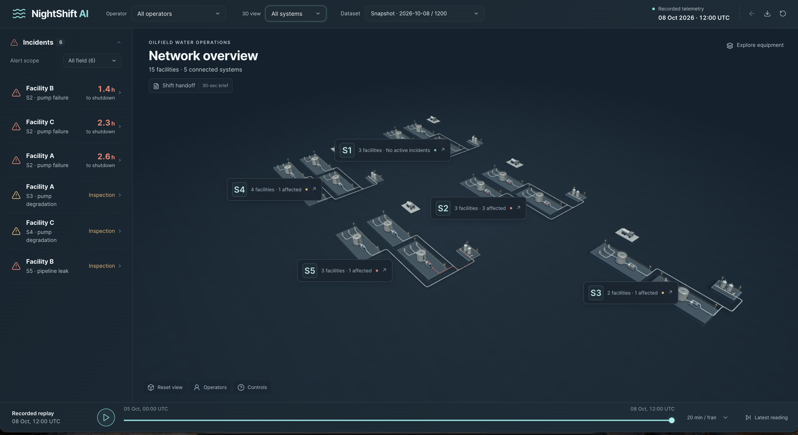
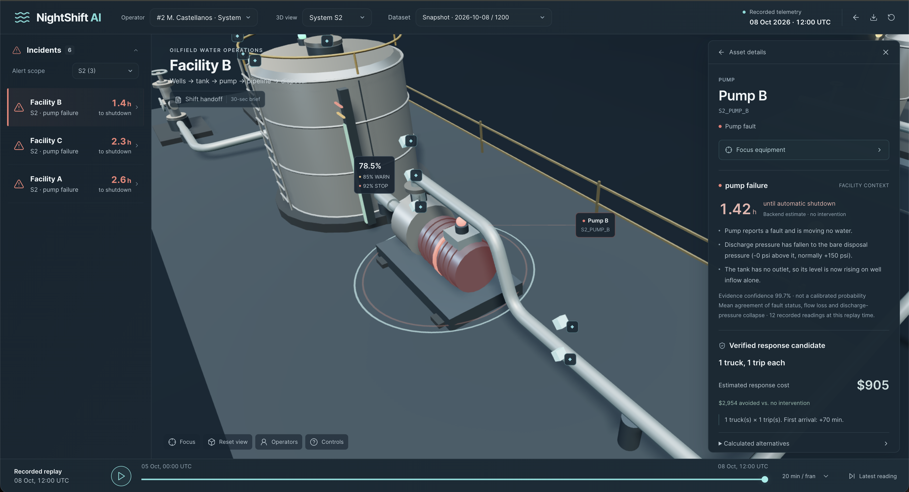
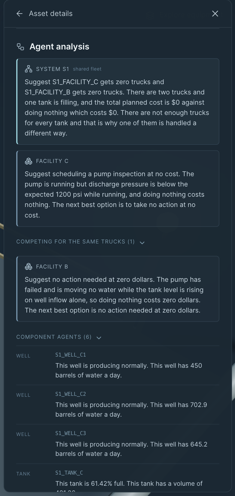

# NightShift

Night-shift console for EOG water-disposal facilities. It watches recorded sensor readings, flags a fault as soon as the data supports it, and puts the cheapest legal response on screen before a tank forces the wells offline.



## The problem

At night, a facility problem does not wait for the next shift. A pump stops, a line starts leaking, or a pump wears down, and the tank keeps filling. If nobody sees it in time, the tank hits its shutdown limit, the wells shut in, and the facility loses oil and gas revenue until the repair is done.

EOG’s night operation does not have a single place that does both jobs at once: catch the disruption as soon as it shows up in the sensors, and choose the response that loses the least money. Trucks are shared across facilities in the same system, so the cheap move for one tank can be the expensive move for the field.

## The solution

NightShift is an operations console for that gap. The screen shows the network, the live faults, and what to do about each one. The money decision is not left to a model.

1. **Detect.** Python reads `network.json`, `ops.json`, and `telemetry.csv` and compares each sensor to the reading a healthy facility would produce. A slow leak or a wearing pump is caught from the drift, not from a late hard threshold. A failed pump is caught when flow and discharge collapse.
2. **Price the response.** As soon as a pump failure is on the board, the planner simulates the tank and searches truck trips and early well shut-ins. It keeps the cheapest plan that stays under the shutdown limit. Facilities that share a yard are solved together, so one truck is never promised to two tanks.
3. **Coordinate the crew.** Nemotron agents sit on top of that result. A component agent reports its own asset, a facility agent weighs the plan for that site, and a system agent covers the shared trucks. They explain the same verified numbers. They do not recalculate the plan and they do not dispatch equipment.

Leaks and worn pumps still move water, so those alerts call for an inspector and do not invent a shutdown countdown.



<!-- Drop the agent panel screenshot here.

-->

## What the operator sees

- Every system, facility, tank, pump, and pipeline on a schematic, with the fault highlighted.
- A countdown band for a filling tank, and the recommended trucks, shut-ins, or decision to wait.
- Replay of the recording, so a past moment can be inspected as if it were happening now.
- A short shift handoff the next operator can read without opening the charts.

The console is decision support. It does not command pumps, wells, or trucks. Nemotron is required for investigation and the agent panel.



## Run locally

Python 3.10+ and Node.js 20.9+.

```bash
python3 -m venv .venv
.venv/bin/pip install -r requirements.txt
.venv/bin/python -m uvicorn backend.main:app --reload --port 8000
```

In a second terminal:

```bash
cd frontend && npm install && npm run dev
```

Open http://localhost:3000. API docs are at http://localhost:8000/docs.

On Windows, use `.venv/Scripts/python.exe` instead of `.venv/bin/python`.

Any folder under `data/eog` that contains `network.json`, `ops.json`, and `telemetry.csv` appears in the dataset picker. Drop a judging `test/` folder there and switch to it. No code change.

## Check

```bash
.venv/bin/python -m unittest discover -s tests -v
.venv/bin/python -m scripts.validate_history
cd frontend && npm run typecheck && npm run build
```
